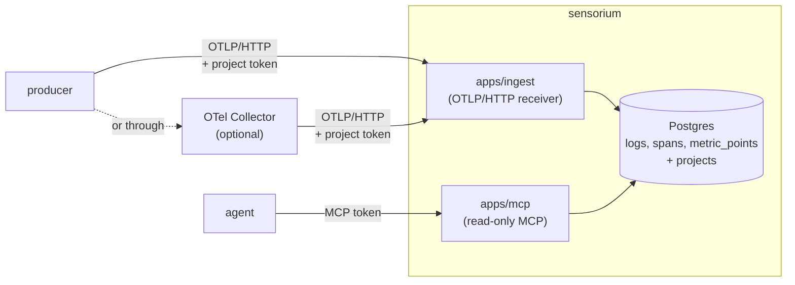

<div align="center">

<h1>sensorium</h1>

<p><strong>Observability for agents: OpenTelemetry in, MCP out.</strong></p>

[](https://github.com/zyx1121/sensorium/actions)
[](https://github.com/zyx1121/sensorium/pkgs/container/sensorium)
[](https://sensorium.zyx.tw)
[](LICENSE)

**English** | [繁體中文](README.zh-TW.md) | [简体中文](README.zh-CN.md)

</div>

```console
$ error_summary { "project": "reel", "windowMinutes": 1440 }
{"project": "reel", "windowMinutes": 1440, "errorLogCount": 1, "errorSpanCount": 0, "topMessages": [{"body": "round failed", "count": 1}]}
```

Your services already speak OpenTelemetry, but the reader of their logs at 3 am is now often an agent, not a person with a dashboard. sensorium keeps the logs, traces and metrics of many services in one Postgres store and gives them to agents over MCP. "What broke?" becomes one tool call.

## Features

- **Ingests OpenTelemetry**: OTLP over HTTP, as JSON or protobuf, at `/v1/logs`, `/v1/traces` and `/v1/metrics`.
- **Keeps projects apart**: each project has its own ingest token, and the token decides where its records land.
- **Answers agents**: 8 read-only MCP tools at `/mcp`.
- **Expires data by itself**: metrics after 14 days, and spans and logs after 30, by default.

## Quick start

```sh
curl -fsSLO https://raw.githubusercontent.com/zyx1121/sensorium/main/compose.yaml
curl -fsSL -o .env https://raw.githubusercontent.com/zyx1121/sensorium/main/.env.example
# set POSTGRES_PASSWORD and SENSORIUM_MCP_TOKEN in .env, for example with `openssl rand -hex 32`
docker compose up -d
```

This starts Postgres and applies the schema. It also runs the receiver on port 8787, the MCP endpoint on port 8788 and a retention sweep every 24 hours, all from `ghcr.io/zyx1121/sensorium`.

> [!IMPORTANT]
> Both ports listen on 127.0.0.1, and tokens travel in the Authorization header. Put a reverse proxy with TLS in front before anything outside the machine talks to sensorium.

With one host for both endpoints, the proxy sends `/mcp` to port 8788 and everything else to port 8787. In Caddy:

```caddyfile
sensorium.example.com {
	handle /mcp* {
		reverse_proxy 127.0.0.1:8788
	}
	handle {
		reverse_proxy 127.0.0.1:8787
	}
}
```

Without Docker, [deploy/](deploy/) has systemd units for a checkout with Bun and a local Postgres.

## Usage

1. Register a project. sensorium prints the token once. A second run for the same name rotates it.

   ```sh
   docker compose run --rm ingest register-project my-service
   ```

2. Point the service's OpenTelemetry exporter at sensorium:

   ```sh
   OTEL_EXPORTER_OTLP_ENDPOINT=https://sensorium.example.com
   OTEL_EXPORTER_OTLP_PROTOCOL=http/protobuf
   OTEL_EXPORTER_OTLP_HEADERS=Authorization=Bearer%20<ingest token>
   ```

   sensorium takes neither gzip nor gRPC. For an exporter that sends only those, put an OpenTelemetry Collector in front, as in [collector/](collector/), with `compression: none` on its otlphttp exporter.

3. Connect an agent:

   ```sh
   claude mcp add --transport http sensorium https://sensorium.example.com/mcp \
     --header "Authorization: Bearer <SENSORIUM_MCP_TOKEN>"
   ```

4. Ask it what broke. `error_summary` and `top_sources` are the usual first calls.

| Tool | Returns |
|------|---------|
| `list_projects` | the projects and their last activity |
| `query_logs`, `query_traces`, `list_traces` | logs, spans and whole traces, with filters |
| `error_summary` | error log and error span counts, with the top messages |
| `top_sources` | the busiest clients, countries and routes |
| `query_metrics` | metric points by name |
| `search` | a text search across logs and spans |

## Configuration

Set these in `.env`. [.env.example](.env.example) documents each one.

| Key | Sets | Default |
|-----|------|---------|
| `POSTGRES_PASSWORD` | the bundled Postgres password | required |
| `SENSORIUM_MCP_TOKEN` | the bearer token that every agent sends to `/mcp` | required |
| `SENSORIUM_VERSION` | the image tag that compose runs | `latest` |
| `SENSORIUM_BIND` | the address of the two ports | `127.0.0.1` |
| `SENSORIUM_INGEST_PORT`, `SENSORIUM_MCP_PORT` | the published ports | `8787`, `8788` |
| `SENSORIUM_RETENTION_METRIC_DAYS` | days of metrics to keep | `14` |
| `SENSORIUM_RETENTION_SPAN_DAYS`, `SENSORIUM_RETENTION_LOG_DAYS` | days of spans and logs to keep | `30` |
| `SENSORIUM_RETENTION_AHEAD_DAYS` | days of metric partitions to create ahead | `7` |
| `DATABASE_URL`, `PORT`, `MCP_PORT` | a run from source only | |

Size the metric window against real traffic. One busy Proxmox host writes about 2.4 GB of metrics a day, so 14 days take about 33 GB of disk.

## How it works



- Registration binds each ingest token to one project. sensorium records the `service.namespace` that a producer claims, but never uses it for scoping. The token alone decides the project.
- The MCP endpoint has one shared token for trusted readers, and reads cross projects.
- `metric_points` has one partition per UTC day, so expiring metrics drops whole tables and frees the space at once.

## Limits

- Ingest accepts uncompressed OTLP/HTTP with `application/json` or `application/x-protobuf`. Other types get a 415, and gzip bodies get a 400.
- Histogram points store the aggregate `sum` as the value, not the buckets. They show movement, not percentiles.
- Ingest has no rate limits or payload size caps yet.
- `search` uses `ILIKE`, not full-text search.
- `top_sources` reads its fields from the jsonb attributes, with no dedicated columns or indexes yet.
- sensorium sets `http_status_code` on inbound spans only, so the status of a callee never changes `error_summary` or `top_sources`.

## For AI agents

Facts for coding agents and LLM tools. The rules for changing the code are in [AGENTS.md](AGENTS.md).

- **Summary**: OTLP/HTTP receiver and read-only MCP server on one Postgres store, with per-project ingest tokens and automatic retention.
- **Type**: service
- **Interfaces**: HTTP `POST /v1/logs`, `/v1/traces`, `/v1/metrics` (port 8787). MCP at `/mcp` (streamable HTTP, port 8788). CLI `bin/sensorium` (ingest, mcp, migrate, register-project, retention).
- **Install**: `docker compose up -d` with `compose.yaml` and `.env` from this repo
- **Run**: `docker compose up -d`
- **Verify**: `docker compose run --rm ingest register-project test`, send one OTLP log, then call `query_logs` for `test`
- **Config**: `POSTGRES_PASSWORD`, `SENSORIUM_MCP_TOKEN`, `SENSORIUM_VERSION`, `SENSORIUM_BIND`, `SENSORIUM_INGEST_PORT`, `SENSORIUM_MCP_PORT`, `SENSORIUM_RETENTION_*`, `DATABASE_URL`
- **Secrets**: `SENSORIUM_MCP_TOKEN` and the database password in `.env`. Registration prints each ingest token once.
- **Limits**: no gzip, no gRPC, no rate limits. Reads cross projects for every MCP token holder.

## Development

```sh
bun install
cp .env.example .env   # set DATABASE_URL and SENSORIUM_MCP_TOKEN
bun run db:migrate
bun run --filter @sensorium/ingest dev    # :8787
bun run --filter @sensorium/mcp dev       # :8788
bun run typecheck && bun run lint && bun run test
```

You need Bun 1.3 and a Postgres at `DATABASE_URL`. CI builds the image and runs [scripts/smoke.sh](scripts/smoke.sh) against a real `docker compose up`. The script registers a project, sends a log over OTLP and reads it back over MCP. Each push to main publishes `:sha-<commit>`, and a `v*` tag publishes the SemVer tags and `latest`.

## License

[MIT](LICENSE)
