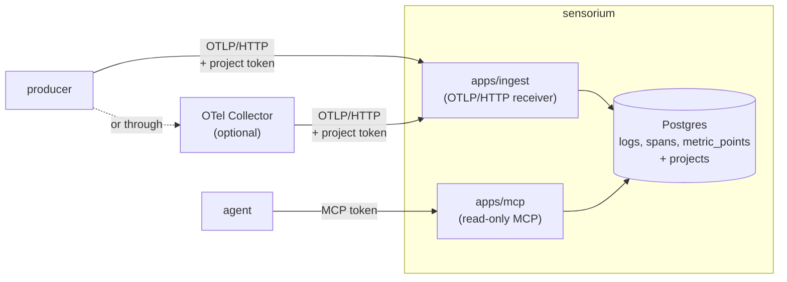

<!-- 翻譯自 README.md @ docs/readme-template-v2。只翻 "For AI agents" 以上的章節，英文版更新時一起改。 -->

<div align="center">

<h1>sensorium</h1>

<p><strong>給 agent 用的可觀測性：OpenTelemetry 進，MCP 出。</strong></p>

[](https://github.com/zyx1121/sensorium/actions)
[](https://github.com/zyx1121/sensorium/pkgs/container/sensorium)
[](https://sensorium.zyx.tw)
[](LICENSE)

[English](README.md) | **繁體中文** | [简体中文](README.zh-CN.md)

</div>

```console
$ error_summary { "project": "reel", "windowMinutes": 1440 }
{"project": "reel", "windowMinutes": 1440, "errorLogCount": 1, "errorSpanCount": 0, "topMessages": [{"body": "round failed", "count": 1}]}
```

你的服務早就會送 OpenTelemetry，但凌晨三點讀 log 的，越來越常是 agent，而不是盯著儀表板的人。sensorium 把許多服務的 log、trace 和 metric 存在同一個 Postgres，再透過 MCP 交給 agent。「哪裡壞了？」變成一次工具呼叫。

## 功能

- **接收 OpenTelemetry**：在 `/v1/logs`、`/v1/traces` 和 `/v1/metrics` 接收 OTLP over HTTP，JSON 或 protobuf 都可以。
- **專案彼此隔離**：每個專案有自己的寫入權杖，由權杖決定資料寫到哪裡。
- **回答 agent**：在 `/mcp` 提供 8 個唯讀的 MCP 工具。
- **自動清除舊資料**：預設 metric 保留 14 天，span 和 log 保留 30 天。

## 快速開始

```sh
curl -fsSLO https://raw.githubusercontent.com/zyx1121/sensorium/main/compose.yaml
curl -fsSL -o .env https://raw.githubusercontent.com/zyx1121/sensorium/main/.env.example
# 在 .env 設定 POSTGRES_PASSWORD 和 SENSORIUM_MCP_TOKEN，例如用 `openssl rand -hex 32` 產生
docker compose up -d
```

這會啟動 Postgres 並套用 schema，同時從 `ghcr.io/zyx1121/sensorium` 執行 8787 port 的接收端、8788 port 的 MCP 端點，以及每 24 小時一次的清除工作。

> [!IMPORTANT]
> 兩個 port 都只聽 127.0.0.1，權杖放在 Authorization 標頭裡傳送。在機器外的任何東西連進來之前，前面要先放一個有 TLS 的反向代理。

兩個端點共用一個網域時，代理把 `/mcp` 送到 8788，其他都送到 8787。Caddy 的寫法：

```caddyfile
sensorium.example.com {
	handle /mcp* {
		reverse_proxy 127.0.0.1:8788
	}
	handle {
		reverse_proxy 127.0.0.1:8787
	}
}
```

不用 Docker 的話，[deploy/](deploy/) 有給 Bun 加本機 Postgres 用的 systemd unit。

## 使用方式

1. 註冊專案。權杖只會印出一次，對同一個名稱再執行一次會輪替權杖。

   ```sh
   docker compose run --rm ingest register-project my-service
   ```

2. 把服務的 OpenTelemetry exporter 指向 sensorium：

   ```sh
   OTEL_EXPORTER_OTLP_ENDPOINT=https://sensorium.example.com
   OTEL_EXPORTER_OTLP_PROTOCOL=http/protobuf
   OTEL_EXPORTER_OTLP_HEADERS=Authorization=Bearer%20<ingest token>
   ```

   sensorium 不收 gzip 也不收 gRPC。只會送這兩種的 exporter，前面要放一個 OpenTelemetry Collector，參考 [collector/](collector/)，並把 otlphttp exporter 設成 `compression: none`。

3. 連接 agent：

   ```sh
   claude mcp add --transport http sensorium https://sensorium.example.com/mcp \
     --header "Authorization: Bearer <SENSORIUM_MCP_TOKEN>"
   ```

4. 問它哪裡壞了。通常先呼叫 `error_summary` 和 `top_sources`。

| 工具 | 回傳 |
|------|------|
| `list_projects` | 所有專案和最後活動時間 |
| `query_logs`、`query_traces`、`list_traces` | 可篩選的 log、span 和完整 trace |
| `error_summary` | 錯誤 log 和錯誤 span 的數量，以及最常出現的訊息 |
| `top_sources` | 最常出現的用戶端、國家和路由 |
| `query_metrics` | 依名稱查 metric 資料點 |
| `search` | 在 log 和 span 裡做文字搜尋 |

## 設定

在 `.env` 設定這些值，[.env.example](.env.example) 有每一項的說明。

| 參數 | 作用 | 預設 |
|------|------|------|
| `POSTGRES_PASSWORD` | 內建 Postgres 的密碼 | 必填 |
| `SENSORIUM_MCP_TOKEN` | 每個 agent 送到 `/mcp` 的 bearer 權杖 | 必填 |
| `SENSORIUM_VERSION` | compose 執行的映像檔 tag | `latest` |
| `SENSORIUM_BIND` | 兩個 port 監聽的位址 | `127.0.0.1` |
| `SENSORIUM_INGEST_PORT`、`SENSORIUM_MCP_PORT` | 對外開放的 port | `8787`、`8788` |
| `SENSORIUM_RETENTION_METRIC_DAYS` | metric 保留天數 | `14` |
| `SENSORIUM_RETENTION_SPAN_DAYS`、`SENSORIUM_RETENTION_LOG_DAYS` | span 和 log 保留天數 | `30` |
| `SENSORIUM_RETENTION_AHEAD_DAYS` | 預先建立幾天的 metric 分區 | `7` |
| `DATABASE_URL`、`PORT`、`MCP_PORT` | 只有從原始碼執行時需要 | |

依實際流量估算 metric 的保留天數。一台忙碌的 Proxmox 主機每天約寫 2.4 GB 的 metric，14 天約佔 33 GB。

## 運作方式



- 註冊時，每個寫入權杖綁定一個專案。sensorium 會記下 producer 宣稱的 `service.namespace`，但不會用它來分專案，只由權杖決定。
- MCP 端點用一組共用權杖給信任的讀取者，可以跨專案讀取。
- `metric_points` 每個 UTC 日一個分區，所以清除 metric 時直接刪整張表，空間立刻釋放。

## 限制

- 只接收未壓縮、`application/json` 或 `application/x-protobuf` 的 OTLP/HTTP。其他類型回 415，gzip 回 400。
- histogram 資料點只存加總 `sum`，不存分桶，看得出變化，算不了百分位數。
- 接收端還沒有速率限制，也沒有內容大小上限。
- `search` 用的是 `ILIKE`，不是全文檢索。
- `top_sources` 直接從 jsonb 屬性讀欄位，還沒有專用欄位或索引。
- sensorium 只在進站的 span 設 `http_status_code`，所以被呼叫端的狀態不會影響 `error_summary` 或 `top_sources`。

## 其他

給 AI agent 的結構化資訊與開發說明在[英文版](README.md#for-ai-agents)。

## 授權

[MIT](LICENSE)
